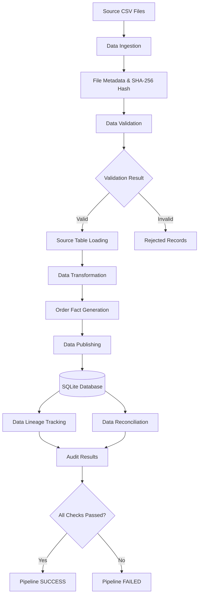

# DataFlow Audit
### Building Trustworthy, Traceable & Reliable Data Pipelines

<p align="center">
  <strong>An End-to-End Auditable Data Engineering Solution</strong>
</p>

<p align="center">
  
  
  
  
  
</p>

---

## 1. Project Overview

**DataFlow Audit** is a Python-based data engineering pipeline designed to process, validate, transform, publish and audit structured datasets while maintaining complete source-to-output traceability.

The project addresses a critical challenge in data engineering: ensuring that published data is not only processed correctly but can also be traced, verified and audited.

The pipeline captures execution metadata, validates data quality, records rejected records, tracks transformation stages, establishes data lineage and performs automated reconciliation.

Every pipeline execution is associated with a unique Run ID, allowing individual executions and their processing history to be investigated.

### Key Objectives

- Build a modular and reproducible data processing pipeline.
- Maintain end-to-end data traceability.
- Detect and isolate data quality issues.
- Prevent duplicate publishing during pipeline reruns.
- Capture execution failures and processing metrics.
- Verify published outputs through reconciliation.
- Measure performance across different dataset sizes.

## 2. System Architecture

The solution follows a modular ETL architecture with integrated auditing and reconciliation.

### End-to-End Workflow



### Pipeline Components

| Component | Responsibility |
|---|---|
| Ingestion | Read source CSV files and capture file metadata |
| Validation | Validate schemas, records and relationships |
| Source Loading | Load validated records into relational tables |
| Transformation | Generate consolidated order-level facts |
| Publishing | Publish transformed data using safe UPSERT operations |
| Lineage | Connect source records to published outputs |
| Reconciliation | Verify counts, financial totals and lineage |
| Audit Logging | Capture execution history, metrics and failures |

## 3. Core Capabilities

### 3.1 Data Ingestion

- CSV-based ingestion.
- SHA-256 file hashing.
- File size and row-count tracking.
- Source file metadata capture.
- Missing and empty file detection.
- Malformed CSV handling.

### 3.2 Data Quality and Validation

The validation layer checks:

- Missing required fields.
- Duplicate primary keys.
- Unexpected or missing columns.
- Invalid email formats.
- Invalid foreign-key references.
- Negative quantities.
- Invalid prices.
- Schema inconsistencies.

Invalid records are captured in the rejected-records table with their source information and rejection reasons.

### 3.3 Data Transformation

The transformation layer integrates customer, order and order-item datasets to generate consolidated order facts.

Key operations include:

- Customer and order integration.
- Order-item aggregation.
- Total quantity calculation.
- Financial amount calculation.
- Handling orders without associated items.
- Financial precision using integer cents.

### 3.4 Data Publishing

- SQLite-based relational storage.
- UPSERT-based publishing.
- Duplicate order protection.
- Database transaction handling.
- Rollback support for failed publishing operations.

### 3.5 Audit and Observability

Every pipeline execution maintains:

- Unique Run ID.
- Start and end timestamps.
- Input file details.
- Processing stage information.
- Input and output row counts.
- Rejected record counts.
- Published record counts.
- Execution status.
- Error messages.

### 3.6 Data Lineage

Data lineage establishes a relationship between the original source records and their corresponding published output records.

Each lineage entry captures:

| Field | Description |
|---|---|
| Run ID | Pipeline execution identifier |
| File ID | Source file identifier |
| Source Record ID | Original source record |
| Output Table | Destination table |
| Output Record ID | Published record identifier |
| Published At | Publication timestamp |

This allows the system to trace published order facts back to the source customer, order and order-item records.

## 4. Data Reconciliation

DataFlow Audit implements four reconciliation checks to verify the correctness of processed data.

| Reconciliation | Purpose |
|---|---|
| Input Row Reconciliation | Verify valid and rejected records account for all input rows |
| Order Count Reconciliation | Compare valid, transformed and published order counts |
| Amount Reconciliation | Compare source and published financial totals |
| Lineage Reconciliation | Verify expected and recorded lineage relationships |

**Pipeline success condition:** All four reconciliation checks must pass. Otherwise, the pipeline is marked as failed.

## 5. Database Architecture

SQLite is used to maintain business data, published outputs and audit information.

### Business Tables

| Table | Description |
|---|---|
| customers | Customer information |
| orders | Order information |
| order_items | Individual order items |
| order_facts | Consolidated order-level facts |
| order_status_history | Order status history |

### Audit Tables

| Table | Description |
|---|---|
| pipeline_runs | Pipeline execution history |
| input_files | Source file metadata |
| transformation_logs | Processing stage information |
| rejected_records | Rejected records and reasons |
| output_lineage | Source-to-output relationships |

The database uses primary keys, foreign keys, uniqueness constraints and indexes to support relational integrity and efficient queries.

## 6. Technology Stack

| Technology | Usage |
|---|---|
| Python | Core pipeline implementation |
| Pandas | Data manipulation and transformation |
| SQLite | Relational database |
| SQL | Data operations and reconciliation |
| Pytest | Automated testing |
| Faker | Synthetic data generation |
| NumPy | Data generation |
| Hashlib | SHA-256 file hashing |
| Logging | Pipeline monitoring |
| Git & GitHub | Version control |

## 7. Project Structure

```text
DataFlow-Audit/
│
├── data/
│   ├── input/
│   ├── sample/
│   ├── output/
│   ├── quarantine/
│   └── benchmarks/
│       ├── small/
│       ├── medium/
│       ├── large/
│       └── benchmark.db
│
├── src/
│   ├── __init__.py
│   ├── database.py
│   ├── data_generator.py
│   ├── edge_case_generator.py
│   ├── ingestion.py
│   ├── validation.py
│   ├── transformation.py
│   ├── publishing.py
│   ├── pipeline.py
│   └── reconciliation.py
│
├── tests/
│   ├── test_database.py
│   ├── test_data_generator.py
│   ├── test_ingestion.py
│   ├── test_validation.py
│   ├── test_transformation.py
│   ├── test_publishing.py
│   ├── test_reconciliation.py
│   ├── test_pipeline_failure.py
│   ├── test_pipeline_idempotency.py
│   ├── test_pipeline_recovery.py
│   ├── test_pipeline_schema_drift.py
│   ├── test_pipeline_malformed_csv.py
│   └── test_pipeline_rejected_records.py
│
├── docs/
├── prompts/
├── reports/
│
├── main.py
├── benchmark.py
├── inspect_audit.py
├── check_benchmark.py
├── migrate_lineage.py
├── config.yaml
├── requirements.txt
├── README.md
└── .gitignore
```

## 8. Installation and Setup

### Prerequisites

- Python 3.10 or higher.
- Git.
- Windows, Linux or macOS.

### Clone the Repository

```bash
git clone https://github.com/Deva0703/DataFlow-Audit.git
cd DataFlow-Audit
```

### Create a Virtual Environment

```bash
python -m venv venv
```

### Activate the Environment

Windows PowerShell:

```powershell
.\venv\Scripts\Activate.ps1
```

Linux/macOS:

```bash
source venv/bin/activate
```

### Install Dependencies

```bash
pip install -r requirements.txt
```

## 9. Running the Pipeline

Run the main application:

```bash
python main.py
```

The pipeline processes the sample customer, order and order-item CSV files.

The execution generates:

- Pipeline execution details.
- Ingestion and validation metrics.
- Transformed order facts.
- Published database records.
- Audit logs.
- Source-to-output lineage.
- Reconciliation results.

Default database:

```text
data/dataflow_audit.db
```

## 10. Automated Testing

The project includes automated tests for core functionality, data quality and pipeline reliability.

Execute the complete test suite:

```bash
python -m pytest -v
```

### Latest Verified Test Results

| Metric | Result |
|---|---:|
| Total Tests | 51 |
| Passed | 51 |
| Failed | 0 |
| Execution Time | 6.50 seconds |

### Testing Areas

- Database initialization.
- Synthetic data generation.
- CSV ingestion.
- File hash consistency.
- Missing and malformed files.
- Schema drift.
- Duplicate records.
- Invalid foreign-key references.
- Data transformation.
- Financial calculations.
- Publishing and rollback.
- Idempotent reruns.
- Pipeline failure handling.
- Recovery after transformation failures.
- Reconciliation checks.

## 11. Performance Benchmarking

The pipeline was evaluated using three synthetic datasets to measure processing performance at different scales.

### Dataset Configuration

| Dataset | Customers | Orders | Order Items | Total Input Rows |
|---|---:|---:|---:|---:|
| Small | 100 | 500 | 1,207 | 1,807 |
| Medium | 1,000 | 10,000 | 24,801 | 35,801 |
| Large | 5,000 | 50,000 | 125,257 | 180,257 |

### Benchmark Results

| Dataset | Execution Time | Throughput |
|---|---:|---:|
| Small | 1.459 sec | 1,238.50 records/sec |
| Medium | 5.003 sec | 7,155.87 records/sec |
| Large | 21.296 sec | 8,464.53 records/sec |

### Large Dataset Highlights

- 180,257 total input records.
- 5,000 customers.
- 50,000 orders.
- 125,257 order items.
- 50,000 published order facts.
- 225,257 lineage relationships.
- 21.296 seconds execution time.
- 8,464.53 records per second.

Run the benchmark:

```bash
python benchmark.py
```

*Benchmark results were measured in a local Windows development environment. Execution times may vary depending on hardware and system configuration.*

## 12. Reliability and Engineering Design

The project incorporates the following engineering considerations:

| Design Principle | Implementation |
|---|---|
| Idempotency | UPSERT-based publishing |
| Data Integrity | Primary and foreign keys |
| File Identification | SHA-256 hashing |
| Transaction Safety | Database transactions and rollback |
| Data Quality | Validation and rejection handling |
| Observability | Structured execution logging |
| Traceability | Source-to-output lineage |
| Reconciliation | Automated consistency checks |
| Performance | Grouped operations and batched database queries |

## 13. AI Development Assistance

AI tools were used as development assistance for code suggestions, debugging guidance, test-case ideas and documentation.

Generated suggestions were reviewed, integrated and validated through local execution and automated testing.

Supporting AI prompt documentation is maintained in the `prompts/` directory.

## 14. Future Enhancements

Potential future extensions include:

- Cloud-based deployment.
- Incremental data processing.
- Advanced retry and backfill orchestration.
- Monitoring dashboard.
- Additional data source integrations.
- Distributed processing for larger workloads.

These are potential enhancements and are not claimed as completed functionality.

## 15. Conclusion

DataFlow Audit demonstrates how an end-to-end data engineering pipeline can combine data processing with auditability, reliability and traceability.

By integrating ingestion, validation, transformation, publishing, data lineage, reconciliation and automated testing, the solution provides a foundation for building trustworthy data workflows.

> **The goal is not just to move data. It is to make every published record traceable, verifiable and trustworthy.**

---

<p align="center">
  <strong>DataFlow Audit</strong><br>
  AI Data Forward Deployed Engineer Challenge
</p>